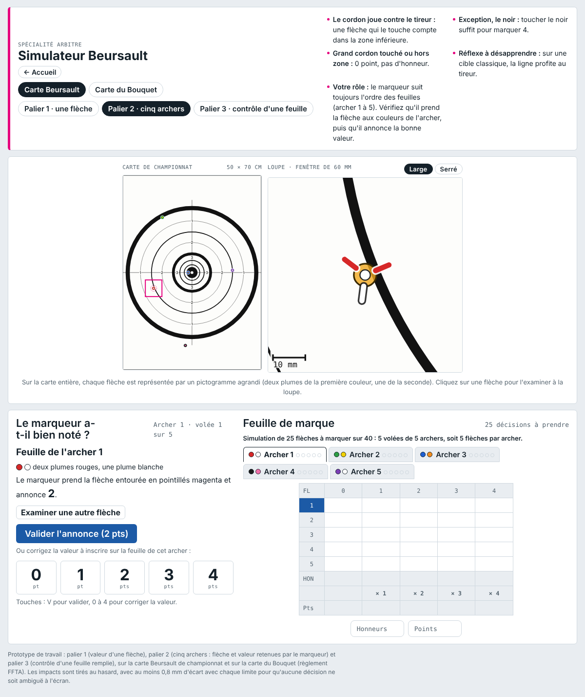

# Simulateur Beursault

Module d'entraînement au marquage des points pour la spécialité **Beursault** de la formation des arbitres fédéraux FFTA.
Page unique, sans dépendance à installer : tout est dans `index.html`.

**Accès en ligne : https://ghibau.github.io/Beursault/**

## Contenu

Deux cartes, au choix à tout moment :

- la **carte Beursault** de championnat (valeurs 4, 3, 2, 1, 0) ;
- la **carte du Bouquet**, avec son marmot (valeurs 3, 2, 1, 0, chapelets).

Trois paliers, présentés sur la page d'accueil :

| Palier | Exercice |
|---|---|
| **1 · Un impact, un score** | Une flèche dans la carte : quelle valeur annoncer ? Simulation de 10 flèches à marquer sur 40. |
| **2 · Cinq archers** | Cinq volées de cinq archers (25 flèches). Le marqueur traite toujours les archers dans le même ordre ; il faut vérifier qu'il prend la bonne flèche (reconnaissable à ses plumes et à son encoche) et qu'il lui attribue la bonne valeur. Un onglet par archer, au-dessus de la feuille de marque. |
| **3 · Contrôle d'une feuille** | Une feuille de 40 flèches déjà remplie : lignes vides, ratures sans visa, cases Honneurs et Points des colonnes, totaux d'honneurs, de chapelets et de points, signatures. |

## Règles de marquage retenues

- Le cordon joue contre le tireur : une flèche qui touche le cordon extérieur d'une zone compte dans la zone inférieure.
- Exception : le noir, où toucher suffit pour la valeur maximale.
- Grand cordon (ou cordon doré au Bouquet) touché ou dépassé : 0 point, pas d'honneur.
- Honneur : flèche valant au moins 1 point. Chapelet (Bouquet) : flèche de 2 ou 3 points.
- La feuille de marque est verticale, comme dans le référentiel : colonnes de valeurs, lignes Honneurs et Points, cases Honneurs / Chapelets / Points, signatures de l'archer et du marqueur. Toute rature (crayon rouge) doit être contresignée.

Les impacts sont tirés au hasard, avec au moins 0,8 mm d'écart avec chaque limite de zone, pour qu'aucune décision ne soit ambiguë à l'écran. Le tube de la flèche mesure 7 mm.

## Fonctionnement

Une seule page HTML, CSS et JavaScript intégrés, cartes dessinées en SVG. Elle s'affiche aussi sur téléphone : la carte et la loupe restent fixées en haut de l'écran pendant qu'on fait défiler la feuille.
Pour l'essayer en local, ouvrir `index.html` dans un navigateur.

## Statut

Prototype de travail. Distinct du jeu « Jugement de cordon » (dépôt GhiBau/Cordons), qui porte sur le jugement du cordon par l'assistant-arbitre.
